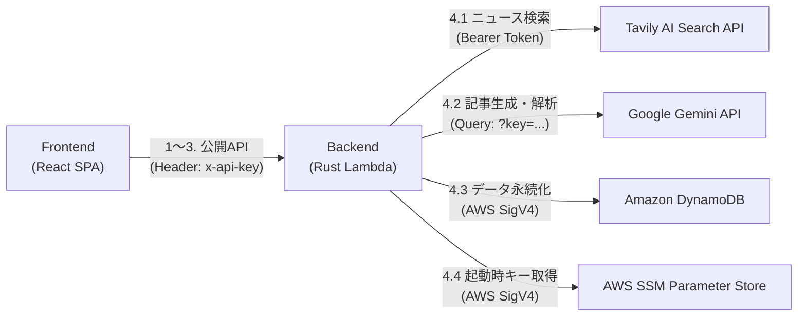

# Web API エンドポイント仕様一覧

本プロジェクト（AI英語学習アプリ）におけるAPI仕様の一覧です。
前半（セクション1〜3）では**フロントエンドからバックエンド（Rust + AWS API Gateway）へ呼び出す公開API**を、後半（セクション4）では**バックエンド（Lambda）から外部・AWSサービス（Tavily, Gemini, DynamoDB, SSM）へ呼び出す内部連携API**をまとめています。



## 共通仕様（フロントエンド ⇔ バックエンド間）

- **認証**: すべてのエンドポイントは、リクエストヘッダーに `x-api-key` を付与する必要があります。
- **ベースURL**: 環境によって異なります。
  - ローカル開発環境: `http://localhost:9000/lambda-url`
  - 本番環境 (AWS): API GatewayのエンドポイントURL (`https://<api-id>.execute-api.ap-northeast-1.amazonaws.com`)

---

## 1. トピック管理API (`/topics`)

実装ファイル: `backend/src/bin/topics.rs`

| 機能ID | メソッド | パス           | 用途                                   | リクエストボディ         | レスポンス例                                                                |
| :----- | :------- | :------------- | :------------------------------------- | :----------------------- | :-------------------------------------------------------------------------- |
| F-005  | `GET`    | `/topics`      | 保存済みのトピック一覧を取得する。     | なし                     | `200 OK`<br>`[{"id": "...", "name": "Technology", "created_at": "..."}]`    |
| F-007  | `POST`   | `/topics`      | 新しいトピックを作成（DBに保存）する。 | `{"name": "トピック名"}` | `201 Created`<br>`{"id": "...", "name": "トピック名", "created_at": "..."}` |
| F-008  | `DELETE` | `/topics/{id}` | 指定したIDのトピックを削除する。       | なし（パスパラメータ）   | `204 No Content`                                                            |

---

## 2. 単語帳API (`/vocabulary`)

実装ファイル: `backend/src/bin/vocabulary.rs`

| 機能ID | メソッド | パス               | 用途                               | リクエストボディ                          | レスポンス例                                                                                 |
| :----- | :------- | :----------------- | :--------------------------------- | :---------------------------------------- | :------------------------------------------------------------------------------------------- |
| F-010  | `GET`    | `/vocabulary`      | 保存済みの英単語一覧を取得する。   | なし                                      | `200 OK`<br>`[{"id": "...", "word": "ubiquitous", "translation": "至る所にある", ...}]`      |
| F-009  | `POST`   | `/vocabulary`      | 新しい英単語を単語帳に登録する。   | `{"word": "単語", "translation": "和訳"}` | `201 Created`<br>`{"id": "...", "word": "単語", "translation": "和訳", "created_at": "..."}` |
| F-011  | `DELETE` | `/vocabulary/{id}` | 単語帳から指定したIDの単語を削除。 | なし（パスパラメータ）                    | `204 No Content`                                                                             |

---

## 3. AIテキスト生成・解析API (`/generate_text`)

実装ファイル: `backend/src/bin/generate_text.rs`

| 機能ID                  | メソッド | パス             | 用途                                                                                                                            |
| :---------------------- | :------- | :--------------- | :------------------------------------------------------------------------------------------------------------------------------ |
| F-001<br>F-002<br>F-003 | `POST`   | `/generate_text` | Gemini 3.5 Flash-liteおよびTavily AI Searchを用いて、英文記事の生成（最新ニュース検索対応）または構文解析・重要単語抽出を行う。 |

### 3.1 英文記事生成 (`action: "generate"`)

トピックに応じた150〜250語のビジネス英語記事を生成します。

**リクエストボディ**:

```json
{
  "action": "generate",
  "topic_name": "Artificial Intelligence in Finance",
  "use_web_search": true
}
```

- `topic_name` (string, 任意): 生成したい記事のトピック。未指定の場合はデフォルトトピック。
- `use_web_search` (boolean, 任意, デフォルト: `false`): `true` にすると、Tavily AI Search API で直近3日間のニュースを検索し、その内容を踏まえた記事と参照URLを返却します。

**レスポンス例 (200 OK)**:

```json
{
  "text": "Recent advancements in artificial intelligence are reshaping financial services...",
  "source_url": "https://www.example.com/news/ai-finance"
}
```

※ `use_web_search: false` の場合、`source_url` は `null` になります。

### 3.2 構文解析・単語抽出 (`action: "analyze"`)

生成された英文をスラッシュリーディング用の意味の塊（セグメント）に分割し、和訳・文法注記・上級ビジネス英単語（CEFR C1レベル）を抽出します。

**リクエストボディ**:

```json
{
  "action": "analyze",
  "text": "Recent advancements in artificial intelligence are reshaping financial services..."
}
```

**レスポンス例 (200 OK)**:

```json
{
  "segments": [
    {
      "id": 1,
      "text": "Recent advancements",
      "translation": "最近の進展は",
      "grammar_note": "主語(S)"
    },
    {
      "id": 2,
      "text": "in artificial intelligence",
      "translation": "人工知能における",
      "grammar_note": "前置詞句(修飾語)"
    },
    {
      "id": 3,
      "text": "are reshaping financial services.",
      "translation": "金融サービスを再構築している。",
      "grammar_note": "動詞(V) + 目的語(O)"
    }
  ],
  "keywords": [
    {
      "word": "reshaping",
      "meaning": "再構築している、形を変えている",
      "part_of_speech": "verb",
      "example": "AI is reshaping the financial industry."
    }
  ]
}
```

### 3.3 主なHTTPエラーステータス

| ステータス                  | 原因                                                                                                                                                | メッセージ / 挙動                                                                            |
| :-------------------------- | :-------------------------------------------------------------------------------------------------------------------------------------------------- | :------------------------------------------------------------------------------------------- |
| `400 Bad Request`           | リクエストボディが不正                                                                                                                              | `"Invalid Request Body"`                                                                     |
| `401 Unauthorized`          | `x-api-key` ヘッダーが未指定または不一致                                                                                                            | `"Unauthorized"`                                                                             |
| `405 Method Not Allowed`    | POST 以外のHTTPメソッド                                                                                                                             | `"Method Not Allowed"`                                                                       |
| `503 Service Unavailable`   | `use_web_search: true` 時にTavily検索が失敗（エラーまたは結果0件）、またはGemini APIがリトライ・フォールバック後も高負荷（503/429）で応答不能な場合 | `"Web search failed..."` または `"Gemini AI is currently experiencing high demand (503)..."` |
| `500 Internal Server Error` | Gemini APIエラーまたは通信エラー                                                                                                                    | `"Gemini API returned an error"`                                                             |

---

## 4. バックエンド内部連携 API（外部 AI・検索・AWS サービス）

バックエンド（Rust Lambda）の内部から `reqwest` または `aws-sdk-rust` を用いて呼び出している外部APIおよびAWSマネージドサービスの通信仕様です。
（単体テストでは、これらすべてのエンドポイントURLをローカルの `wiremock::MockServer` に差し替えて検証しています）

### 4.1 Tavily AI Search API（最新ニュース検索）

- **呼び出し元**: `backend/src/bin/generate_text.rs` (`call_tavily_search`)
- **発火条件**: `/generate_text` で `action: "generate"` かつ `use_web_search: true` が指定された場合（ダミーモード時を除く）
- **エンドポイント**: `POST https://api.tavily.com/search`
- **認証方式**: HTTPヘッダー `Authorization: Bearer <TAVILY_API_KEY>`

**リクエストボディ**:

```json
{
  "query": "<topic_name> latest news",
  "topic": "news",
  "days": 3,
  "max_results": 3,
  "include_answer": false
}
```

| フィールド       | 設定値                  | 意図・役割                                                   |
| :--------------- | :---------------------- | :----------------------------------------------------------- |
| `query`          | `"<topic> latest news"` | 指定トピックの最新ニュースに焦点を当てる検索クエリ           |
| `topic`          | `"news"`                | 一般Webページではなくニュース記事に特化して検索              |
| `days`           | `3`                     | 直近3日以内に公開された新鮮なニュースのみに限定              |
| `max_results`    | `3`                     | LLMプロンプトのトークン肥大化を防ぎつつ複数ソースを参照      |
| `include_answer` | `false`                 | Tavily側のAI要約を無効化し、検索結果の生スニペットのみを取得 |

**レスポンス例（抜粋・パース対象フィールド）**:

```json
{
  "results": [
    {
      "title": "Quantum Leap in AI",
      "url": "https://tech.example.com/ai-quantum",
      "content": "Researchers have discovered new AI paradigms..."
    }
  ]
}
```

> **バックエンドでの後続処理 (`format_news_context`)**:
>
> - **単一記事へのフォーカス選定**: 取得した最大3件の候補の中から、本文が100文字以上ある充実した記事を優先してランダムに**1件だけ**選出します（複数の無関係なニュースが1つの英文記事に混ざって起承転結が崩れたり、`source_url` と本文が不一致になるのを防ぐため）。
> - 選出した1件の記事の `content` を最大 **1000文字**（UTF-8文字単位）までプロンプト内の `--- Latest News Article ---` に埋め込み、その記事の `url` を参照元URL（`source_url`）として1対1で紐付けます。
> - 通信エラーまたは `results` が空（0件）の場合は、曖昧なフォールバックを行わずフロントエンドへ `503 Service Unavailable` を返します。

---

### 4.2 Google Gemini API（英文記事生成・構文解析）

- **呼び出し元**: `backend/src/bin/generate_text.rs` (`call_gemini_with_retry`)
- **使用モデル**: プライマリ `gemini-3.5-flash-lite`（高負荷 `503`/`429` 発生時はリトライ後に `gemini-3.5-flash` へ自動フォールバック）
- **エンドポイント**: `POST https://generativelanguage.googleapis.com/v1beta/models/<model>:generateContent?key=<GEMINI_API_KEY>`
- **認証方式**: URLクエリパラメータ `key=<GEMINI_API_KEY>`

**リクエストボディ**:

```json
{
  "contents": [
    {
      "parts": [
        {
          "text": "<build_generate_prompt または build_analyze_prompt で生成したプロンプト文字列>"
        }
      ]
    }
  ],
  "generationConfig": {
    "temperature": 0.9,
    "responseMimeType": "application/json"
  }
}
```

| 設定項目           | 設定値               | 意図・役割                                                                     |
| :----------------- | :------------------- | :----------------------------------------------------------------------------- |
| `temperature`      | `0.9`                | 同じトピックでも毎回多様で自然なビジネス英文記事が生成されるよう創造性を高める |
| `responseMimeType` | `"application/json"` | Gemini の Structured Outputs（JSONモード）を強制し、構文崩れを防止する         |

**レスポンス例（抜粋・パース対象フィールド）**:

```json
{
  "candidates": [
    {
      "content": {
        "parts": [
          {
            "text": "{\"text\": \"Generated business English article...\", \"source_url\": \"https://...\"}"
          }
        ]
      }
    }
  ]
}
```

> **バックエンドでの後続処理 (`extract_json_payload`)**:
>
> - `candidates[0].content.parts[0].text` から文字列を取り出し、万一 Markdown コードブロック（` ```json ... ``` `）が含まれていても最初の `{` から最後の `}` までを安全に抽出して JSON パースし、フロントエンドへ返却します。

---

### 4.3 AWS SDK 内部通信（DynamoDB / SSM Parameter Store）

AWS SDK for Rust を介して行われる AWS 内部 API 通信（HTTP POST / JSON プロトコル、SigV4 署名認証）の一覧です。

| 接続先サービス          | AWS API アクション | 呼び出し元                                         | 対象リソース / パラメータ                                                        | 用途                                                           |
| :---------------------- | :----------------- | :------------------------------------------------- | :------------------------------------------------------------------------------- | :------------------------------------------------------------- |
| **SSM Parameter Store** | `GetParameter`     | 全 Lambda の `main()` 起動時                       | `/eng-app/api-key`<br>`/eng-app/gemini-api-key`<br>`/eng-app/tavily-api-key`     | コールドスタート時にシークレットを復号取得しメモリにキャッシュ |
| **Amazon DynamoDB**     | `Query`            | `GET /topics`<br>`GET /vocabulary`                 | Table: `eng-app-table`<br>KeyCondition: `PK = "TOPIC"` または `PK = "VOCAB"`     | トピック一覧・単語帳一覧の高速検索                             |
| **Amazon DynamoDB**     | `PutItem`          | `POST /topics`<br>`POST /vocabulary`               | Table: `eng-app-table`<br>Item: `PK`, `SK` (`TOPIC#<uuid>` / `WORD#<uuid>`), etc | 新規トピック・新規単語の保存                                   |
| **Amazon DynamoDB**     | `DeleteItem`       | `DELETE /topics/{id}`<br>`DELETE /vocabulary/{id}` | Table: `eng-app-table`<br>Key: `PK`, `SK`                                        | 指定IDのトピック・単語の削除                                   |
