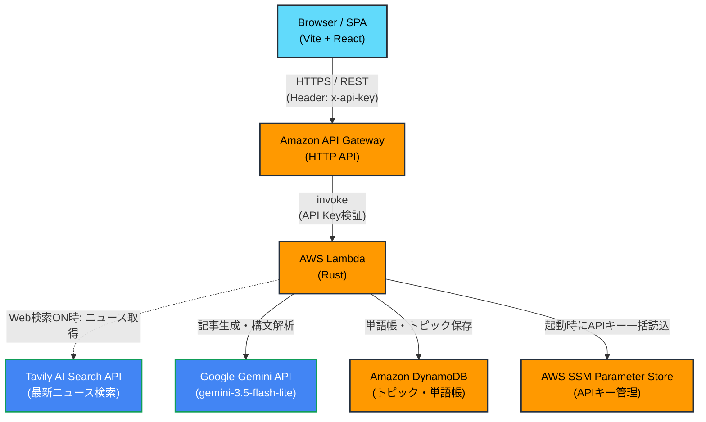
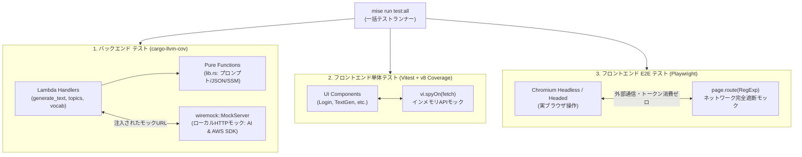

# 全体アーキテクチャ設計書

## 1. システム構成図



## 2. コンポーネント役割

| コンポーネント         | 役割                                                                                                        |
| ---------------------- | ----------------------------------------------------------------------------------------------------------- |
| フロントエンド (React) | ユーザーUI。トピック選択、Web検索ON/OFF、生成記事の読解・構文解析表示・単語保存を行う。                     |
| API Gateway            | エンドポイントの提供、CORS制御、スロットリングによるレートリミット。                                        |
| Lambda (Rust)          | メインロジック。起動時(`main`)にSSMからAPIキーをキャッシュし、Tavily/Gemini呼び出しやDB操作を超高速に処理。 |
| DynamoDB               | シングルテーブル設計を用いたデータの永続化（トピック・単語帳）。                                            |
| Tavily AI Search API   | 最新ニュース検索エンジン。トピックに関連する直近3日間のニュース記事とURLを取得。                            |
| Gemini API             | LLMエンジン (`gemini-3.5-flash-lite`)。英文記事生成および構文・単語解析を担当。                             |
| SSM Parameter Store    | `x-api-key`、`GEMINI_API_KEY`、`TAVILY_API_KEY` の安全な保持・管理。                                        |

## 3. ディレクトリ・モジュール構成方針

```
ai-english-learner/          # プロジェクトルート
├── .github/workflows/       # GitHub Actions ワークフロー定義 (ci.yml, deploy.yml)
├── .githooks/               # Git フック定義 (pre-commit)
├── .mise/tasks/             # タスクランナー定義
│   ├── build/               # ビルド用 (back, front, all)
│   ├── dev/                 # ローカル開発用 (back, front)
│   ├── deploy/              # 本番デプロイ用 (infra, front, all)
│   ├── test/                # 自動テスト用 (back, front, e2e, all)
│   ├── ci                   # CIパイプライン一括実行 (pre-commit + test:all + build:all)
│   ├── fmt                  # コード・インフラ・ドキュメント一括フォーマッタ
│   ├── pre-commit           # コミット前品質・セキュリティチェック
│   └── setup                # 初期環境構築スクリプト (Rust, Cargo Lambda, Playwright, Node, Terraform, Git Hooks)
├── backend/                 # サーバー側リポジトリ (Rust)
│   ├── infra/               # Terraformコード (AWSリソース定義)
│   └── src/                 # Rustコード (lib.rs: 共通純粋関数, bin/: 各Lambda関数)
├── docs/                    # ドキュメントディレクトリ
│   ├── architecture.md      # 本ドキュメント
│   ├── design.md            # 基本設計書
│   ├── requirements.md      # 要件定義
│   ├── CONTRIBUTING.md      # 開発手順書
│   └── learning/            # 学習・設計判断の記録 (ADR等)
├── frontend/                # クライアント側リポジトリ (Vite + React 19)
│   ├── e2e/                 # 実ブラウザE2Eテスト (Playwright: mocks.ts, *.spec.ts)
│   ├── playwright.config.ts # Playwright 設定 (Vite 開発サーバー自動連動)
│   └── src/                 # Reactソースコード (components/, test/)
└── README.md                # プロジェクト概要
```

---

## 4. テストアーキテクチャ（3層モック分離）

本システムは、CI環境や手元開発で外部APIトークンを一切消費せず、安全・高速に実行可能な3層の自動テストアーキテクチャ（計90テスト）を採用しています。



- **バックエンド (44件 / 行カバレッジ 91.3%・領域カバレッジ 92.1%)**: `wiremock` によりローカルで HTTP モックサーバーを立ち上げ、外部 AI API（`ApiEndpoints`）だけでなく AWS SDK（`DynamoDB` / `SSM` の `endpoint_url`）も注入することで、トレイト等による複雑な抽象化を導入せずに全ハンドラの正常系・異常系を完全シミュレート。`cargo-llvm-cov` でカバレッジとHTMLレポートを出力。
- **フロントエンド単体・コンポーネント (40件 / 行カバレッジ 87.0%・分岐カバレッジ 87.7%)**: `Vitest` 上でブラウザの `fetch` を直接モック化。API Gateway やバックエンドを起動せずにコンポーネントの状態遷移を数秒で検証し、`@vitest/coverage-v8` でブランチカバレッジとHTMLレポートを出力。
- **フロントエンド E2E (6件)**: `Playwright` により実ブラウザでログインから記事生成、スラッシュリーディング表示、単語帳登録までの実操作シナリオを検証。`page.route` によるネットワーク完全遮断でトークン消費ゼロを保証。
