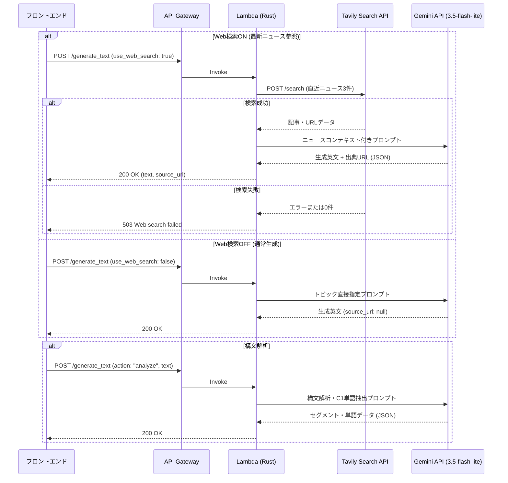

# 5. AI (Gemini API) & Web検索 (Tavily) 連携とコスト最適化

本プロジェクトでは、検索特化エンジン **Tavily AI Search API** と Google の生成AI **Gemini API (`gemini-3.5-flash-lite`)** を連携させ、高速・高精度かつ完全月額0円での英語学習コンテンツ生成を実現しています。

## 1. アーキテクチャの変遷: 検索と生成の責務分離 (Decoupled Search & LLM)

当初はGemini API組み込みのGoogle Searchツール（`googleSearch`）を検討しましたが、無料枠におけるAPI制限や原因不明の500/503エラーが多発しました。
そこで、**「検索」と「要約・英文生成」の責務を明確に分離**するアーキテクチャに刷新しました。

| 責務           | 採用技術                  | 選定理由・特徴                                                                                                                                       |
| :------------- | :------------------------ | :--------------------------------------------------------------------------------------------------------------------------------------------------- |
| **Web検索**    | **Tavily AI Search API**  | ・LLM/RAG向けに設計されたAI特化型検索エンジン<br>・直近3日間のニュース記事本文とURLをクリーンなJSONで取得可能<br>・月間1,000回まで完全無料で利用可能 |
| **生成・解析** | **Gemini 3.5 Flash-lite** | ・Googleの最新超軽量・超高速モデル<br>・無料枠が大きくレイテンシが極めて低い<br>・150〜250語の英文生成や構文・語彙解析に十分な表現力を持つ           |

---

## 2. データ処理フロー

ユーザーが「最新ニュースを参照する」をONにした場合とOFFにした場合で、Lambda内部の処理が分岐します。



---

## 3. 実装詳細

### 3.1 Tavily AI Search API の呼び出し (`call_tavily_search`)

`reqwest` クライアントを用い、トピックに関連する直近のニュースを検索します。
万一検索が失敗した場合、勝手に古い知識でフォールバックしてユーザーを混乱させないよう、**即座にエラー（503）を返すフェイルファスト設計**にしています。

```rust
let request_body = json!({
    "query": format!("{} latest news", query),
    "topic": "news",
    "days": 3,
    "max_results": 3,
    "include_answer": false
});

let res = http_client
    .post("https://api.tavily.com/search")
    .header("Authorization", format!("Bearer {}", tavily_api_key))
    .json(&request_body)
    .send()
    .await;
```

### 3.2 プロンプト設計と語数最適化 (150〜250語)

英語速読・構文把握の学習効果を最大化しつつAPIレイテンシを短縮するため、生成する英文記事の語数を **150〜250語** に厳格に制限しています。

- **対象レベル**: TOEIC 800+ / CEFR B2-C1 向けの実践的な上級ビジネス英語
- **構造化出力の担保**:
  - Gemini APIの `generationConfig: { "responseMimeType": "application/json" }` を指定。
  - LLMが万一Markdown記法（` ```json ... ``` `）を出力した場合に備え、Rust側で最初の `{` から最後の `}` までを部分文字列抽出する堅牢なパースロジックを実装。

### 3.3 RAG（検索拡張生成）における「単一記事フォーカス」設計 (`format_news_context`)

Web検索（Tavily）で取得したニュースをLLM（Gemini）に渡して記事を書かせる際、**「検索結果の複数記事をすべてプロンプトに結合して渡すか、1件に絞って渡すか」** は生成文章の品質を左右する極めて重要な設計判断です。

#### ❌ アンチパターン：複数の検索結果（3件）をすべて結合してLLMに渡す

当初は Tavily で取得した最大3件のニュース（各400文字）を `[1] ... [2] ... [3] ...` とすべて結合して Gemini に渡していました。しかし、これには以下の3つの重大な欠陥がありました：

1. **起承転結のない散漫な文章になる**: たとえば「Technology」というトピックで検索すると、「Appleの新製品」「EUのAI規制」「半導体工場の建設」という別々の3件のニュースが返ってきます。これを150〜250語という短い英語記事に無理やり全部盛り込もうとするため、1つのテーマを深掘りできず、無関係な話題がぶつ切りで繋がった支離滅裂な文章になってしまいます。
2. **参照元URL (`source_url`) と記事内容の乖離**: UIに表示する `source_url` は1つ（`results[0].url`）しかないため、2件目・3件目のニュース内容が本文に混ざると、ユーザーが参照リンクを開いた際に「記事に書いてある内容がリンク先に載っていない」という不整合が起きます。
3. **1件あたりの情報量（コンテキスト）不足**: トークン数を抑えるために1件あたり400文字で切り詰めていたため、個々のニュースの背景や結末が途切れてしまいます。

#### ⭕ ベストプラクティス：候補を3件取得し、バックエンドで「良質な1件」を選定して深く書かせる

この問題を解決するため、`format_news_context`（`backend/src/lib.rs`）を以下の**「候補取得 → フィルタリング＆ランダム1件選定 → 深掘り生成」**のパイプラインに改善しました：

```rust
pub fn format_news_context_with_seed(results: &[TavilyResult], seed: usize) -> (String, String) {
    if results.is_empty() {
        return (String::new(), String::new());
    }

    // 1. 本文が極端に短い（100文字未満の）ハズレ記事を除外
    let rich_candidates: Vec<&TavilyResult> = results
        .iter()
        .filter(|r| r.content.chars().count() >= 100)
        .collect();

    // 2. 充実した候補の中からランダムに1件だけを選出
    let selected = if !rich_candidates.is_empty() {
        rich_candidates[seed % rich_candidates.len()]
    } else {
        &results[seed % results.len()]
    };

    // 3. 1件に集中するため、コンテキスト上限を従来の400文字 → 1000文字に拡大
    let source_url = selected.url.clone();
    let truncated_content: String = selected.content.chars().take(1000).collect();
    let news_context = format!(
        "Title: {}\nURL: {}\nContent: {}",
        selected.title, selected.url, truncated_content
    );

    (news_context, source_url)
}
```

- **この設計によって得られた3つのメリット**:
  1. **明確な起承転結（Narrative Flow）**: プロンプトでも「Focus deeply on this single news story and structure the article with a clear narrative flow (introduction/background, key developments, and business implications)」と指示することで、1つのニュースの「背景 ➔ 出来事 ➔ ビジネスへの示唆」が論理的に展開される質の高いビジネス英語記事になります。
  2. **出典URLとの100%一致**: 選ばれた1件の `url` をそのまま `source_url` として返すため、生成された英文記事と参照元リンクの内容が1対1で完全に一致します。
  3. **連続学習時のバリエーション確保**: Tavily からは `max_results: 3` で複数候補を取得し、その中からランダム（ナノ秒シード）に1件を選ぶため、同じ日に同じトピックで再度「Generate Now」を押しても別の最新ニュースが選ばれやすくなります。

### 3.4 構文解析（スラッシュリーディング）とC1単語抽出

`action: "analyze"` の際は、以下のルールでJSONデータを生成します。

- **セグメント分割**: 意味の塊（チャンク）ごとに分割し、和訳と文法役割（S/V/O/前置詞句など）を付与。
- **語彙抽出**: 学習者が既に知っている基礎〜中級単語（A1〜B2）はスキップし、ビジネスで役立つ上級語彙（CEFR C1レベル）のみを最大10単語抽出。

---

## 4. コストと無料枠の維持

- **Gemini API (`gemini-3.5-flash-lite`)**: 無料枠内で1日あたり十分な回数のリクエストをカバー。
- **Tavily AI Search API**: 開発者向け無料枠で月1,000回の検索が可能（個人学習用としては十分）。
- **ダミーモード**: ローカル開発時はトピック名 `test` またはAPIキー未設定でAPI呼び出しをバイパスし、無駄なトークン消費を完全に防止。
