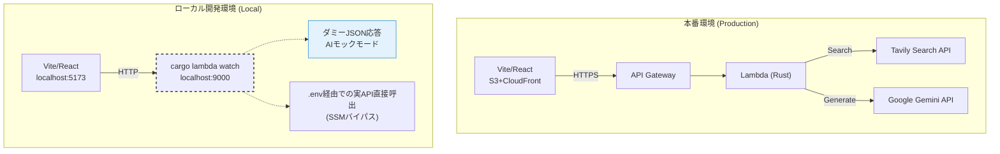
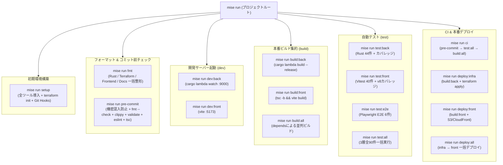
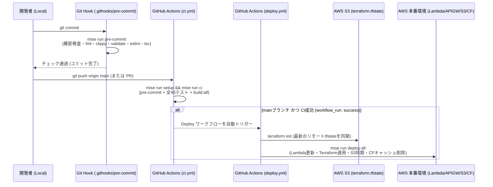

# 6. サーバーレス＆AIアプリのローカル開発手法

クラウドやAIに依存するアプリ開発における「デプロイの手間」「API課金・制限」を解決し、**クラウド課金ゼロ・API制限ゼロ**でフロントエンドを高速開発するための仕組み。

## 環境構成の比較（本番 vs ローカル）



## 1. `cargo lambda watch` によるバックエンドのローカル起動

毎回AWSにZIPデプロイする手間を省き、ローカルマシン上に擬似的なLambda環境（ポート9000）を立ち上げる。

```bash
$ cargo lambda watch --env-file .env
```

- フロントエンドの通信先を `http://localhost:9000/...` に向けるだけで、本番同等のテストが可能。

## 2. AIダミーモード（モック）の仕組み

UI微調整のたびに本物のGemini / Tavily APIを叩くと利用上限（レートリミット）に到達してしまうため、バックエンド側で通信をバイパスする仕組み。

### ダミーモードの発動条件

以下のいずれかを満たした場合、外部API通信をスキップして**固定のダミーJSON**を即座に返す。

1. **マジックワード（記事生成時）**: 入力トピック名が `test` や `dummy` で始まる。
2. **ダミー記事の構文解析時 (`action: "analyze"`)**: 解析対象テキスト（`text`）が `"(Dummy Mode)"` で始まる（ダミー生成した記事に対して「Slash Reading & Analysis」タブを開いた際にも、誤って本物の Gemini API を叩いてトークンを消費しないようにする工夫）。
3. **APIキー未設定**: Gemini APIキーが未設定（空文字、または初期値 `CHANGE_ME_GEMINI_KEY`）。

```rust
// ダミー判定ロジック (backend/src/bin/generate_text.rs)
let is_dummy_mode = topic_name.to_lowercase().starts_with("test")
    || topic_name.to_lowercase().starts_with("dummy")
    || text_to_analyze.starts_with("(Dummy Mode)")
    || gemini_api_key.is_empty()
    || gemini_api_key.as_str() == "CHANGE_ME_GEMINI_KEY";

if is_dummy_mode {
    // 外部APIを叩かず、数ミリ秒で固定データ(Mock JSON)を返す
    return Ok(Response::builder().body(mock_json));
}
```

- **DX (開発体験) の向上**: APIの制限枠や「数秒のAI応答待ち」を気にすることなく、ローカルで**瞬時に**UI・状態遷移のテストを反復できる。

## 3. ローカルでの実API連携テスト (SSMバイパス)

本物のAI応答やTavily検索の精度をローカルで確かめたい場合、AWS SSMにアクセスする必要なく、`backend/.env` に直接キーを定義するだけで動作する仕組み（優先度: 環境変数 > AWS SSM）を設けている。

```rust
// backend/src/lib.rs
pub async fn get_gemini_api_key(ssm_client: &SsmClient) -> String {
    // 1. 環境変数 (ローカル開発用) を優先
    if let Ok(val) = std::env::var("GEMINI_API_KEY") {
        return val;
    }
    // 2. なければ AWS SSM Parameter Store から取得
    ...
}
```

これにより、AWSの認証情報を意識せず、ローカル完結で実APIの疎通・プロンプト検証を安全に行うことができる。

---

## 4. 自動テストとコードカバレッジ (Mise + wiremock + Vitest + Playwright)

開発者が日常的に素早く品質検証を行えるよう、タスクランナー `mise` を起点とした3層の自動テスト基盤を整備している。
どのレイヤーも外部通信を遮断（モック化）しているため、APIキー不要・トークン消費ゼロで安全かつ高速に実行できる。

```bash
# 全体テスト一括実行 (計90件 PASS: バックエンド44件 + 単体40件 + E2E 6件)
mise run test:all

# 個別実行
mise run test:back    # Rust 単体・HTTPモックテスト (44件, 行/領域カバレッジ計測・HTML出力付き)
mise run test:front   # Vitest フロントエンド単体テスト (40件, v8 行/分岐カバレッジ計測・HTML出力付き)
mise run test:e2e     # Playwright 実ブラウザE2Eテスト (6件)
```

### バックエンドのコードカバレッジ (`cargo-llvm-cov`)

LLVMのソースコードインストルメンテーションを活用し、行単位・関数単位の網羅率を正確に計測。
実行時にターミナル出力と同時にHTMLレポートが `backend/target/llvm-cov/html/index.html` に自動生成され、ブラウザで未カバー行をカラー確認できる。

### フロントエンドの高速コンポーネントテスト (`Vitest`)

Viteと設定を共有し、ブラウザを起動せずメモリ上の `jsdom` で React 19 コンポーネントを検証。UIの表示、入力、タブ遷移、ローディングスピナー、エラー表示などを約5秒で全40件自動テストできる。

### 実ブラウザ E2E 自動テスト (`Playwright`)

実ブラウザ（Chromium）を起動し、ログイン、記事生成、構文解析アコーディオン、単語帳保存ダイアログ、CRUDの一連の操作フローを検証。
Playwright のネットワークインターセプト（`page.route`）により外部API通信を遮断し、トークン消費ゼロを保証。

> **画面を見ながらのテスト・デバッグ:**
>
> - `mise run test:e2e --ui`: タイムトラベル可能な公式GUIダッシュボードを起動（推奨）。
> - `mise run test:e2e --headed`: 実際のブラウザウィンドウを開いて自動操作を観察。
> - `mise run test:e2e --debug`: 1行ずつステップ実行しながらデバッグ。

---

## 5. ワンコマンド環境構築 (`mise run setup`) によるセットアップの自動化

開発者が本リポジトリに参画する際の初期環境構築（オンボーディング）の手間を最小化するため、すべてのセットアップ処理を `mise run setup` に集約。

### 自動化されている処理内容

1. **Rust ツールチェーン**: 未インストールの場合は `rustup` および stable ツールチェーンを自動導入。
2. **Cargo Lambda**: Lambda 関数のビルド・エミュレーションツール（`cargo-lambda`）を自動導入。
3. **バックエンドテストツール**: `cargo-llvm-cov` および `llvm-tools-preview` を導入。
4. **フロントエンド依存関係**: `npm install` により全Nodeパッケージを導入。
5. **Playwright ヘッドレスブラウザ**: Chromium バイナリおよび Linux 共有ライブラリ（`libnspr4`, `libnss3`, `libasound2`）を自動配置。
6. **Terraform**: `terraform init` によるプロバイダーおよび S3 リモートステートの初期化（AWS認証情報未設定環境では `-backend=false` に自動フォールバック）。
7. **Git Hooks 自動設定**: `git config core.hooksPath .githooks` を設定し、`git commit` 時に自動で `mise run pre-commit` が走るように構成。

---

## 6. すべての開発ライフサイクルを `mise` タスクへ集約 (Unified Developer Experience)

### なぜ `mise` タスクに集約したのか（背景と課題）

本プロジェクトのようなフルスタック＆サーバーレス環境では、使用する言語やツール、作業ディレクトリが多岐にわたります：

- **バックエンド**: Rust, Cargo, `cargo-lambda`, `cargo-llvm-cov`, `rustfmt`, `clippy` (`backend/`)
- **フロントエンド**: Node.js, npm, Vite, Vitest, Playwright, ESLint, Prettier (`frontend/`)
- **インフラ (IaC) & ドキュメント**: Terraform, AWS CLI (`backend/infra/`), Markdown (`docs/`)

従来の開発スタイルでは、以下のように開発者がディレクトリを行き来し、ツールごとの固有コマンドを暗記して実行する必要がありました：

- バックエンド起動: `cd backend && cargo lambda watch --env-file .env`
- フロントエンド起動: `cd frontend && npm run dev`
- インフラ反映: `cd backend/infra && terraform apply`
- フロントエンドデプロイ: `cd frontend && npm run build && aws s3 sync ...`
- 各種テスト・整形: `cargo test`, `npm test`, `npx playwright test`, `cargo fmt`, `terraform fmt`, `npx prettier`

これにより、「どのディレクトリで実行すべきか」「オプションや引数は何だったか」という認知負荷が生じ、ツールのバージョン違いや PATH の不通によるトラブルが多発しがちでした。

### Mise タスクによる階層的統合アーキテクチャ

プロジェクトルート直下の `.mise/tasks/` 配下にディレクトリ構造でタスクを整理し、**「すべての開発・フォーマット・品質チェック・ビルド・テスト・CI・デプロイ操作がプロジェクトルートから `mise run <task>` で完結する」** 仕組みを構築しました。



| カテゴリ           | タスク名                | 実行内容                                                                                  |
| :----------------- | :---------------------- | :---------------------------------------------------------------------------------------- |
| **環境構築**       | `mise run setup`        | Rust, Cargo Lambda, Playwright, フロント依存, Terraform, Git Hooks の全自動導入・初期化   |
| **整形・品質**     | `mise run fmt`          | `cargo fmt` + `terraform fmt` + `Prettier`（TS/CSS/JSON/YAML/Markdown）の一括整形         |
|                    | `mise run pre-commit`   | `.env`/`tfstate` 混入防止、`fmt --check`、`clippy`、`terraform validate`、`eslint`、`tsc` |
| **ローカル開発**   | `mise run dev:back`     | ポート9000での Lambda エミュレータ起動 (`cargo lambda watch`)                             |
|                    | `mise run dev:front`    | ポート5173での Vite 開発サーバー起動                                                      |
| **ビルド**         | `mise run build:back`   | Rust Lambda のリリースビルド (`cargo lambda build --release`)                             |
|                    | `mise run build:front`  | React / TypeScript の本番バンドルビルド (`npm run build`)                                 |
|                    | `mise run build:all`    | バックエンドとフロントエンドの並列ビルド (`#MISE depends=["build:back", "build:front"]`)  |
| **自動テスト**     | `mise run test:back`    | バックエンド単体・HTTPモックテスト（44件）＋ カバレッジ計測 (HTML/端末)                   |
|                    | `mise run test:front`   | フロントエンド単体・コンポーネントテスト（40件）＋ V8 カバレッジ計測 (HTML/端末)          |
|                    | `mise run test:e2e`     | フロントエンド実ブラウザ E2E テスト（6件, Playwright）                                    |
|                    | `mise run test:all`     | 上記 3 レイヤーの全テスト（計90件）の一括実行                                             |
| **CIパイプライン** | `mise run ci`           | `pre-commit` → `test:all` → `build:all` を直列実行するフル検証パイプライン                |
| **本番デプロイ**   | `mise run deploy:infra` | `build:back` ＋ `terraform init & apply` による AWS インフラ適用                          |
|                    | `mise run deploy:front` | `build:front` ＋ S3 アップロード ＋ CloudFront キャッシュ無効化                           |
|                    | `mise run deploy:all`   | インフラとフロントエンドの一括本番デプロイ                                                |

### 【ノウハウ】Mise ファイルタスクにおける `#MISE depends=[...]` と `mise run` の使い分け

1. **ヘッダーコメント記法の注意点 (`#MISE`)**:
   シェルスクリプト形式のファイルタスク（`.mise/tasks/...`）で説明文や依存関係を認識させるには、`# mise description=...`（小文字・スペースあり）ではなく、**`#MISE description="..."`**（大文字・スペースなし）と記述する必要がある。これにより `mise tasks` コマンドで全タスクの説明が一覧表示される。
2. **並列実行 (`#MISE depends`) vs 直列実行 (`mise run`)**:
   - **`#MISE depends=["build:back", "build:front"]`**: Mise の `depends` はデフォルトで**並列実行**される。お互い独立しているバックエンドとフロントエンドのビルド（`build:all`）では、`depends` を使うことで両方が同時進行しビルド時間を短縮できる。
   - **スクリプト内の `mise run`**: `ci`（`pre-commit` → `test:all` → `build:all`）や `deploy:all`（`deploy:infra` → `deploy:front`）を `depends` で書いてしまうと、すべてが同時にスタートしてしまう。すると「軽い Lint チェックで即座に失敗してほしいのに重いビルドも同時に走る」「`cargo llvm-cov` と `cargo lambda build` が同時に走って `backend/target` の Cargo ファイルロック競合が起きる」「Terraform の output が出る前にフロントのデプロイが走る」といった問題が起きる。そのため、**順序依存があるパイプラインはスクリプト内で `mise run` を直列に呼び出す**のがベストプラクティスである。

---

## 7. Git Hooks と GitHub Actions による CI/CD 自動デプロイのノウハウ

ローカルでのコミットから GitHub への Push、そして AWS 本番環境への自動デプロイまでを一気通貫で自動化するための実践的な設計ノウハウをまとめます。



### 1. `.githooks/pre-commit` によるシフトレフト（コミット前の品質保証）

Git のデフォルトのフックディレクトリ（`.git/hooks/`）は Git の追跡対象外（コミット不可）であるため、そのままではリポジトリをクローンした別環境とフックを共有できません。

- **解決策**: リポジトリ内に `.githooks/pre-commit` ディレクトリを作成して Git 管理下に置き、`mise run setup` の中で **`git config core.hooksPath .githooks`** を自動実行する仕組みにしました。
- **GUI クライアント・IDE 対策**: VS Code などの GUI から Git コミットを行うと、ターミナルの `.bashrc` が読み込まれず `mise` や `cargo` に PATH が通っていないことがあります。そのため、`.githooks/pre-commit` の冒頭で明示的に `export PATH="$HOME/.local/bin:$HOME/.cargo/bin:$PATH"` を宣言してから `mise run pre-commit` を呼び出しています。

### 2. CI (`ci.yml`) と CD (`deploy.yml`) を別ワークフローに分離する設計 (`workflow_run`)

GitHub Actions で CI とデプロイを自動化する際、1つの YAML ファイルに書くのではなく、**`ci.yml`（検証）** と **`deploy.yml`（本番反映）** の2ファイルに分離しています。

```yaml
# .github/workflows/deploy.yml のトリガー設計
name: Deploy

on:
  workflow_run:
    workflows: ['CI']
    types: [completed]
    branches: [main]
  workflow_dispatch:

jobs:
  deploy:
    if: ${{ github.event_name == 'workflow_dispatch' || github.event.workflow_run.conclusion == 'success' }}
```

- **分離のメリット**:
  1. **責務と履歴の明確化**: GitHub の「Actions」タブで「テスト結果（CI）」と「本番リリース履歴（Deploy）」を別々に一覧確認できる。
  2. **安全なゲート制御**: `workflow_run` トリガーと `conclusion == 'success'` 条件を組み合わせることで、**`main` ブランチで CI（全90件のテストとビルド検証）が完全にパスしたときだけ**自動的にデプロイが起動する。
  3. **手動デプロイへの対応 (`workflow_dispatch`)**: CI をやり直さなくても、必要なときに GitHub 画面のボタン1つでデプロイだけを再実行できる。
  4. **同時デプロイの衝突防止 (`concurrency`)**: `concurrency: { group: production-deploy, cancel-in-progress: false }` を指定することで、短時間に連続でマージされた場合でも Terraform の apply が同時実行されてロック競合するのを防ぎ、順番にキューイングして安全にデプロイする。

### 3. フロントエンドのビルド時環境変数 (`VITE_API_URL`) と GitHub Secrets の連携

React (Vite) のような静的 SPA では、`import.meta.env.VITE_API_URL` は「ブラウザ実行時」ではなく**「`npm run build`（`mise run build:front`）を実行した瞬間」に JavaScript バンドルファイルの中に文字列として埋め込まれます**。

- ローカル開発では `frontend/.env` ファイルから読み込まれますが、`.env` は `.gitignore` されているため GitHub Actions 上には存在しません。
- そのため、GitHub の **Repository Secrets** に `VITE_API_URL`（API Gateway の本番 URL）を登録し、GitHub Actions の `env:` で `VITE_API_URL: ${{ secrets.VITE_API_URL }}` として渡しています。Vite は `.env` ファイルがなくても OS の環境変数から自動的に `VITE_*` を読み取ってビルドに埋め込むため、`.env` ファイルを生成する余計なスクリプトを書くことなく綺麗に本番 URL を注入できます。
